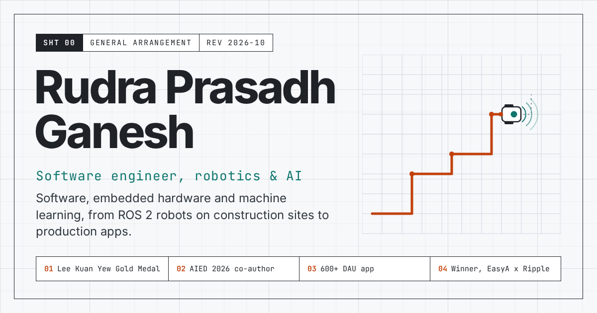

# portfolio

The personal site of Rudra Prasadh Ganesh, software engineer in robotics and AI:
<https://unknown-blaze.github.io/portfolio/>



The page is drawn as an engineering sheet. Each section opens with a title block, sections are
separated by dimension lines, key numbers carry annotation callouts, and the hero shows a small
robot driving tile joints and laying a grout line. Light and dark themes follow the system and
can be switched by hand. Nothing is taken from a template.

## Stack

- Vite, React 18, TypeScript (strict)
- One plain stylesheet with custom properties (`src/styles.css`); no CSS framework or UI kit
- Inter and JetBrains Mono, self-hosted Latin subsets (`src/fonts`, SIL Open Font License)
- No router, no analytics, no cookies

## Editing

All text, links and numbers live in [`src/content.ts`](src/content.ts). Change that one file;
the components only lay it out. Images go in `public/img` as WebP with their width and height
recorded next to them in `content.ts`.

The résumé linked from the Contact section is `public/Rudra_Prasadh_Ganesh_Resume.pdf`.
The social card is `public/og.png`, rendered from `scripts/og-card.html` with
`python3 scripts/render-og.py` (needs Python Playwright with Chromium).

## Run

```sh
npm ci
npm run dev        # http://localhost:5173/portfolio/
npm run build      # typecheck, then build to dist/
npm run preview    # serve dist/ at http://localhost:4173/portfolio/
```

## Deploy

Every push to `main` runs `.github/workflows/deploy.yml`: it builds the site and publishes
`dist/` to the `gh-pages` branch, which GitHub Pages serves.
