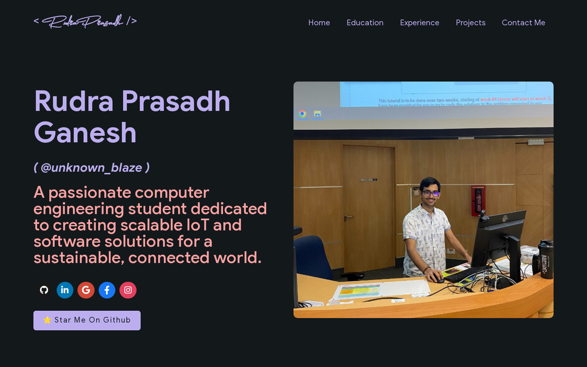

# Rudra Prasadh Ganesh: portfolio site

Source for my personal site at [unknown-blaze.github.io/portfolio](https://unknown-blaze.github.io/portfolio/): education, experience, projects, publications and contact details, built as a single-page React app and served from GitHub Pages.

[](https://react.dev/)
[](https://vitejs.dev/)
[](https://unknown-blaze.github.io/portfolio/)
[](LICENSE)
[](https://unknown-blaze.github.io/portfolio/)



## What is on the site

- Home: greeting, social links and a skills overview
- Education: degrees and certifications
- Experience: work history
- Projects and publications
- Open source: pinned projects, pull requests, issues and organisations, read from JSON files in `src/shared/opensource/`
- Contact

All personal content lives in one file, [`src/portfolio.js`](src/portfolio.js). Edit it to change text, links, skills, experience or projects; the components under `src/containers/` and `src/pages/` render whatever it exports.

## Stack

| Area | Libraries |
|---|---|
| UI | React 18, React Router 6, styled-components, Base Web (with Styletron), React Bootstrap, react-reveal |
| Charts | Chart.js with react-chartjs-2 |
| Data | Apollo Client and GraphQL, plus `git_data_fetcher.mjs` for the GitHub data |
| Build | Vite 6 with `@vitejs/plugin-react`, base path `/portfolio/` |
| Deploy | `gh-pages` to the `gh-pages` branch |
| Tooling | Prettier, Husky, lint-staged |

## Run locally

Node 20 is what CI and the Dockerfile use.

```bash
npm install
npm run dev        # Vite dev server on http://localhost:3000/portfolio/
npm run build      # production build into dist/
npm run preview    # serve the build on http://localhost:4173/portfolio/
```

With Docker, `docker compose up` builds the image from the `Dockerfile` and runs `npm start` with the source mounted, mapping host port 3001 to container port 3000.

### Refresh the GitHub data

`git_data_fetcher.mjs` calls the GitHub GraphQL API and rewrites `src/shared/opensource/pull_requests.json`, `issues.json`, `organizations.json` and `projects.json`. It reads two values from a `.env` file in the repo root:

```bash
GITHUB_TOKEN=<a personal access token with read access>
GITHUB_USERNAME=Unknown-Blaze
```

```bash
node git_data_fetcher.mjs
```

Never commit the `.env` file.

## Deploy

GitHub Pages serves the `gh-pages` branch. To publish:

```bash
npm run deploy
```

`predeploy` runs `npm run build`, then `gh-pages -b gh-pages -d dist` pushes `dist/` to the `gh-pages` branch. The site is live a minute or two later.

## Continuous integration

Two workflows sit in `.github/workflows/`:

- [`nodejs.yml`](.github/workflows/nodejs.yml) (Node.js CI): on pushes and pull requests to `master` and `releases/*`, installs with `npm ci` on Node 20, runs `npm run build` and `npm test`. The default branch is now `main`, so it does not run on pushes to `main`.
- [`pullRequestsDataFetcher.yml`](.github/workflows/pullRequestsDataFetcher.yml): on pushes to a branch named `all`, queries the GitHub GraphQL API for my recent pull requests. It does not write files; the site's data comes from `git_data_fetcher.mjs`.

## Credits

Based on [masterPortfolio](https://github.com/ashutosh1919/masterPortfolio) by Ashutosh Hathidara, released under the MIT License (see [LICENSE](LICENSE)).
